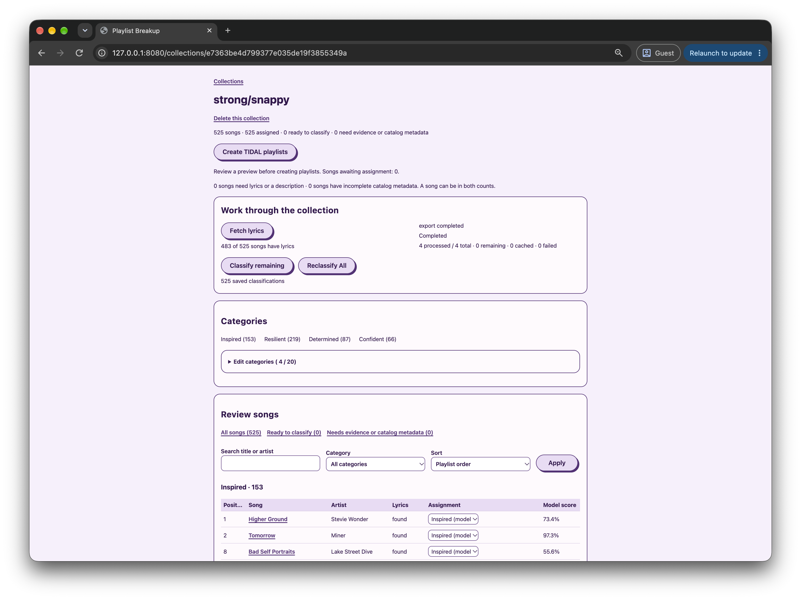

# break-up-playlist



A local Go web application for splitting TIDAL playlists into categories you define. I built it because I wanted to test out Jev, or in this case, OpenJev. 

I also wanted to try out the pattern where you create a demo app using an agent, test things out, develop your idea about how the solution should work, and then rebuild it simpler. This is the second version of the app (with ~~much less~~ no React since I don't know it 😉).

## Run

You need Go 1.26 or later, [Task](https://taskfile.dev/installation/), [uv](https://docs.astral.sh/uv/), Python 3.12, and a TIDAL developer application.

```sh
cp .env.example .env
# Add your TIDAL client ID to .env.
task setup  # Install the OpenJev runtime, unless already available.
task run
```

Open **http://127.0.0.1:8080**. Ctrl+C stops the app and any OpenJev process it started; an existing OpenJev service is left running. The first model download can take a while.

In your TIDAL developer app, enable playlist read/write access and register `http://127.0.0.1:8080/tidal/callback` as the redirect URL. Set `TIDAL_CLIENT_ID` in `.env` and, if required, `TIDAL_CLIENT_SECRET`. Connect TIDAL in the app; playlist creation requires a separate authorization.

## Use

Import a TIDAL playlist, define categories, and classify its songs. Review or change the assignments, then preview and create the new playlists. The original playlist is unchanged.

Songs need lyrics or a description to be classified. The app can fetch lyrics automatically, but matches may be incorrect.

## Configuration and data

See [.env.example](.env.example) for settings. To use an existing local OpenJev service, set `OPENJEV_MODE=external` and `OPENJEV_URL`.

Collections and credentials live in `.data/` and are **not encrypted**. Back up that directory while the app is stopped. Keep `.env` and any custom `DATA_DIR` out of version control.

## Architecture

The app uses a Go server, server-rendered pages, minimal JavaScript, and SQLite. This keeps deployment and frontend maintenance simple, at the cost of a less interactive interface and a design intended for one local user. Domain logic and workflows depend on small interfaces, while TIDAL, lyrics providers, OpenJev, and storage live in separate packages; this makes provider changes and testing easier but adds some indirection.

OpenJev runs locally, keeping classification evidence on the machine but requiring model downloads and capable hardware. Background jobs save progress and can resume interrupted exports, which makes long operations more resilient but requires persisted checkpoints and recovery logic. Lyrics lookups use external services, trading broader coverage for network latency and potentially incorrect matches.

## Checks

```sh
task check  # Run go vet and race-enabled Go tests.
```

Tests use temporary databases and fake providers. Live TIDAL authorization, export, and model classification require credentials and a local model.
